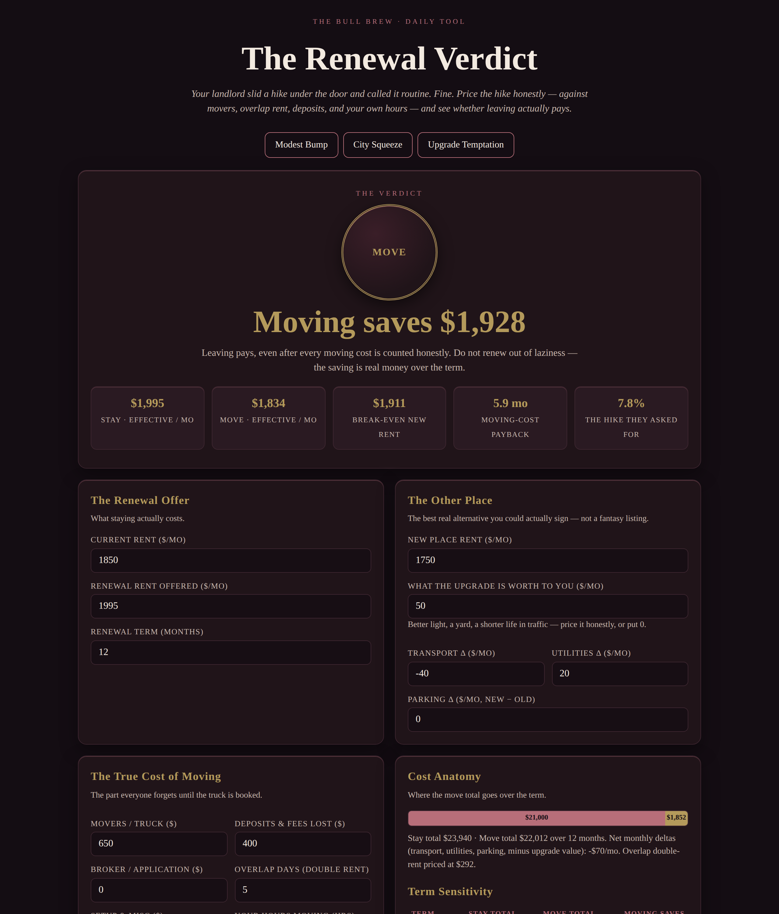

# The Renewal Verdict

**Live:** https://thebullbrew.github.io/renewal-verdict/
**Repo:** https://github.com/thebullbrew/renewal-verdict

## What it does

Your landlord slides a rent hike under the door and calls it routine. This tool prices that hike against the *true* cost of moving — movers and truck, deposits and fees you won't get back, broker charges, overlap days of double rent, setup costs, and your own hours valued at your own rate — plus the new place's monthly deltas for transport, utilities and parking, and an honest dollar value for whatever the upgrade is actually worth to you.

You get a wax-seal verdict — **MOVE**, **SIGN IT**, **CLOSE CALL**, or **RENEWAL TRAP** (the hike is steep, yet moving still costs more — so the real play is negotiating, not leaving) — along with both sides' effective monthly cost, the break-even rent the new place would need to hit, the month the moving bill pays for itself, a cost-anatomy bar, term sensitivity (6–24 months) and new-rent sensitivity tables, three presets, saveable cases in your browser, and a copy-ready summary.

## The method

- **Stay total** = renewal rent × term. Nothing hidden, because staying has no moving bill.
- **Move total** = new rent × term + one-time moving bill + (transport + utilities + parking − upgrade value) × term.
- **One-time bill** itemises movers, lost deposits/fees, broker/application, overlap double-rent (days ÷ 30 × new rent), setup, and your hours × your rate.
- **Break-even new rent** solves the rent at which moving and staying cost exactly the same; **payback** divides the one-time bill by the monthly saving.
- No backend, no accounts, no tracking — everything runs in the page and saved cases live only in your browser's local storage.

Education, not advice. Get the actual truck quote before bluffing your landlord with it.

## How to run

Open `docs/index.html` in any browser, or serve the `docs/` folder with any static host. It installs as a PWA and works offline after the first visit.

---
Part of The Bull Brew daily finance & real-estate tool series — one useful tool, every day. Design: Variation 6, Burgundy Cellar.
